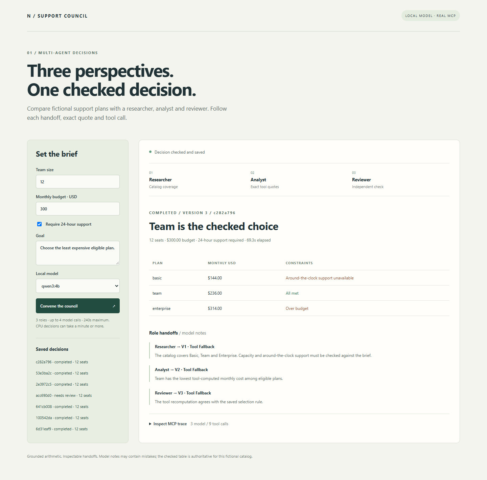
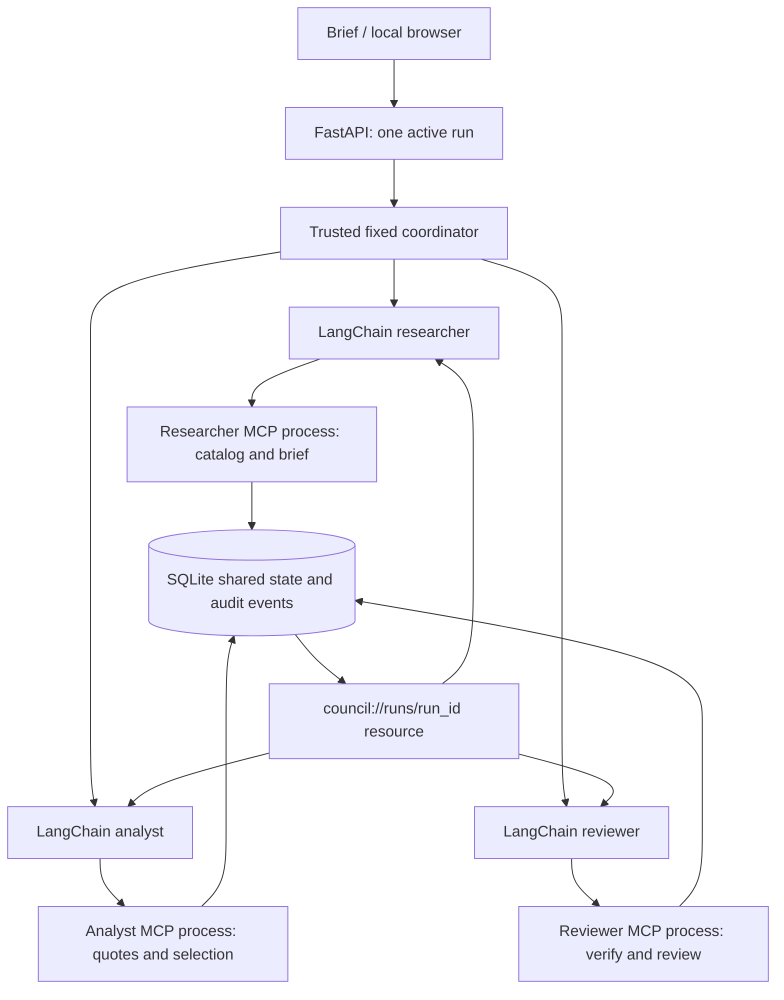

# 01 — Support Council: MCP agents

A local team compares a **fictional** software-support catalog. A researcher briefs an analyst, the analyst chooses a plan using exact quotes, and a reviewer checks the saved decision. Each role discovers and calls a separate, restricted MCP stdio server and reads the previous handoff through an MCP resource. The three roles share local model weights, with separate instructions, contexts and capabilities.

## Run

From `D:\genai-portfolio`:

```powershell
.\scripts\Setup.ps1
.\scripts\Start-Ollama.ps1
# Another terminal, targeting the dedicated D: model store:
$env:OLLAMA_HOST = '127.0.0.1:11435'
ollama pull qwen3:4b
.\scripts\Start-McpAgents.ps1
```

Open <http://127.0.0.1:8101>. The sample brief is **12 seats, $300 monthly budget, around-the-clock support required**. The checked choice is Team at **$236.00**. Basic lacks the required support; Enterprise costs **$314.00**, over budget. A **$10 budget** produces a valid reviewed result with no eligible plan. Prices are invented and there is no purchasing integration.

Model files, SQLite state and traces stay on D:. Default state is `.runtime/mcp-team/state.sqlite3`. `MCP_STATE_PATH` can select another file **inside this repository's `.runtime`**, such as `.runtime/mcp-qa/state.sqlite3` for fictional publishable QA. Scripts set process-local temporary directories under D:; they install no startup service or system-wide setting. API history returns the most recent twenty decisions.



## Architecture



The official MCP Python SDK **2.3.0** supplies real stdio transports, negotiation, tool/schema discovery, resource-template discovery, resource reads and tool calls. The captured protocol is **2026-07-28**. Current [SDK docs](https://py.sdk.modelcontextprotocol.io/), [client guide](https://modelcontextprotocol.io/docs/2026-07-28/develop/build-client) and installed SDK source were checked on 6 November 2026. This implementation uses v2 `MCPServer` and `Client`, including explicit `ToolError` for anticipated validation failures.

LangChain `ChatPromptTemplate` and `ChatOllama.with_structured_output` implement the specialized model roles. A fixed application coordinator controls the three-stage dependency graph. The application chooses which discovered tools to call; this is bounded workflow orchestration, without an open-ended model-controlled tool loop. Role outputs affect the research brief, proposed selection and review approval. Deterministic tools verify selection rather than trusting model arithmetic.

| MCP process | Exposed tools | State authority |
| --- | --- | --- |
| Coordinator | `create_decision` | Create immutable typed requirements, version zero |
| Researcher | `list_plans`, `publish_research` | Complete catalog coverage, version zero → one |
| Analyst | `quote_plan`, `publish_analysis` | Exact integer-cent quotes; least-cost eligible selection, one → two |
| Reviewer | `verify_decision`, `publish_review` | Recompute saved analysis; approve or request attention, two → three |

Every role exposes the resource template `council://runs/{run_id}`. Role processes are bound to one trusted run ID; another run's resource is rejected. Resource reads bypass the SDK cache so handoffs are current. Role tools cannot be escalated through model arguments: a reviewer tool is absent from the analyst server, and a direct call to it is refused by the actual protocol server.

SQLite transactions protect the immutable requirements, catalog hash and ordered expected-version transitions. Stale writes, incomplete catalog coverage and wrong/ineligible choices fail without advancing state. Quotes include integer cents and a canonical dollar string. A deterministic reviewer tool recomputes pricing and eligibility; model review approval is separately required for `completed`. A model refusal remains `needs_review`. Failures retain unfinished state and trace; starting a new run is explicit rather than replaying writes automatically.

## Bounds and narrative handling

Each run allows **four model calls**, **twelve tool calls**, **three resource reads** and **240 seconds** overall. The usual successful path uses three model calls and nine tools. Only the analyst gets one correction attempt after a rejected selection. Model calls use a bounded context/output, CPU inference and disabled external tracing. One active run per API process avoids uncontrolled competition on this laptop.

The first actual model run chose the correct plan but described cents as dollars in its notes. That failure is retained in [the initial capture](../../docs/mcp-initial-note-failure.json) and [diagnosis](../../docs/mcp-initial-note-failure.md). Final prompts request qualitative notes with explicit unit instructions. A numeric/currency literal in a note triggers a **labeled tool fallback**; the original model output remains in the trace. The visible price table always comes from deterministic quotes. This literal boundary does not prove arbitrary qualitative notes true; inspect the table and trace when reviewing a decision.

This is a fixed, small catalog workflow. There is no general web research, shell tool, generated-code execution, MCP HTTP deployment, independent model training or external account action. Separate stdio processes restrict exposed application tools; they are **not an OS sandbox** and run only repository-owned handlers. General agent execution would need a stronger threat model and isolation.

## Verify

```powershell
.\scripts\Test.ps1
# With the API using the dedicated QA path and Ollama running:
.\.venv\Scripts\python.exe scripts/probe-mcp.py --state-path D:\genai-portfolio\.runtime\mcp-qa\state.sqlite3
npm ci --cache .cache/npm
npm run test:mcp-ui
.\.venv\Scripts\python.exe scripts/evaluate-mcp.py --eval-lab-root D:\agent-eval-lab
```

Set `$env:MCP_STATE_PATH='D:\genai-portfolio\.runtime\mcp-qa\state.sqlite3'` **before** starting the API for QA. The probe confirms the persisted run from a separate SQLite connection. It exercises actual successful/no-fit model decisions plus direct MCP role-escalation, stale-write and other-run-resource failures. Offline tests separately use fixture role outputs over real MCP subprocess transports; those tests make no model calls.

Evidence: [live requests and protocol traces](../../docs/mcp-live.json), [browser results](../../docs/mcp-browser.json), desktop/mobile screenshots and [Agent Eval Lab replay](../../docs/mcp-eval/report.html). The adapter reuses that existing repository's contracts, runner and report renderer without changing it. Replay checks selection/state/tool paths, makes no fresh inference and reports replay overhead rather than model latency. These authored samples are smoke evidence, not a broad agent-quality benchmark.

The final HTTP probes took **74.883s** and **58.287s** on this laptop's CPU, each using three actual model calls, nine MCP tool calls and three resource reads. Both final selections and reviews passed; all three negative protocol probes were rejected with state unchanged. **All six final captured handoff notes used the labeled tool fallback**, because this small model continued to include numeric literals despite the prompt. The model's proposed plan and review boolean were still used and independently checked; original prose is retained as untrusted model output in the trace. The complete portfolio suite passed **137 tests**, including **24 MCP/state/API checks**; captured-trace replay passed **2/2** contracts with zero execution errors.
