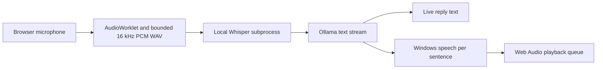

# Relay · Local voice agent

Record a short English question, watch the transcript and streamed reply, and hear the answer. Relay runs Whisper, Ollama and Windows speech locally. You can stop recording, cancel a turn or replay the last completed reply in the same tab.

## Start locally

Use the portfolio's Python 3.13 environment and Windows with an installed desktop speech voice. Run setup from the D: checkout.

```powershell
cd D:\genai-portfolio
.\scripts\Setup-Voice.ps1
.\scripts\Start-Ollama.ps1
```

In a second terminal, pull the chat model into the portfolio instance if needed, then start Relay.

```powershell
$env:OLLAMA_HOST='127.0.0.1:11435'
ollama pull qwen2.5:1.5b
.\scripts\Start-Voice.ps1
```

Open <http://127.0.0.1:8102> in Edge. Choose **Record question**, allow microphone access and ask “What is the capital of France?” Choose **Stop and send**. The app also sends when the 12-second capture limit is reached. **Cancel** stops the active turn or playback. **Replay reply** plays the completed speech held in the tab.

Setup downloads the pinned English tiny.en model to `.models/voice-whisper-tiny.en`. Faster Whisper 1.2.1 uses CTranslate2 4.8.5 with CPU int8 and four threads. The default reply uses `qwen2.5:1.5b` on CPU and `Microsoft Zira Desktop` for speech. Set `VOICE_MODEL` or `VOICE_TTS_NAME` in the launch terminal to use another installed local model or desktop voice.

## Audio and streaming



- The browser captures after a click and permission grant. It stops microphone tracks before sending audio. The API validates the WAV header, PCM format, duration, byte size and level. Audio, transcript and reply stay in memory during a live turn.
- Whisper runs in a replaceable worker adapter. Ollama sends reply deltas and the speech adapter produces PCM for sentence chunks. The server streams text and WAV chunks as newline-delimited JSON. The browser decodes and queues audio as it arrives.
- One turn can run at a time. A recording is limited to 12 seconds, the model to 96 tokens, and the response to 500 characters and three speech chunks. A turn has a 55-second processing deadline. Cancellation or disconnect closes the model stream and stops active speech workers. The browser also stops scheduled playback.
- The UI handles denied or missing microphone access, quiet input, unavailable local dependencies and interrupted streams. This is an English, turn-based experience. Speech recognition starts after capture and the displayed timings measure server work separately from recording and listening time.

## Verification

With Relay running, use `uv run --frozen python scripts/probe-voice.py` for the actual CPU API checks. The script generates fictional audio with the installed local voice, verifies its transcription and spoken reply, and records cancellation. It writes the synthetic question and actual synthesized response to the recorded demo. [Audio demo](../../docs/voice-demo.wav).

Run `npm ci --cache .cache/npm` once for the browser harness. Then run `node scripts/check-voice-ui.cjs` after the API probe. Edge uses a dedicated `.runtime` profile and a synthetic microphone file generated by the probe. It exercises the real capture, recognition and playback path. The permission denial test simulates `NotAllowedError`. [Browser evidence](../../docs/voice-browser.json), [desktop](../../docs/voice-desktop.png), [mobile](../../docs/voice-mobile.png).

The final API capture passed both voiced turns, including **two actual streamed speech chunks** in the reading example. The single-fact turn completed in **5.61s** and the two-sentence turn in **13.29s** under concurrent regression load. The latter's first speech was ready at **10.07s**. The earlier cold model turn took **24.66s**, and the separate browser turn took **5.39s**. Explicit cancellation during transcription and after the first model delta, plus a client disconnect, released the active turn. [Live API evidence](../../docs/voice-live.json).

`scripts/Test.ps1` runs the frozen regression suite. The voice tests use explicit fixtures for stream order, input validation, partial provider output, worker cancellation routing and the single-turn limit. The browser smoke test uses synthetic input, so its results cover the browser microphone path with a virtual device. Manual use requires access to an actual microphone and speaker.

The implementation uses documented browser capture, local inference and speech APIs. [AudioWorklet](https://developer.mozilla.org/en-US/docs/Web/API/AudioWorklet), [Faster Whisper](https://github.com/SYSTRAN/faster-whisper), [English model](https://huggingface.co/Systran/faster-whisper-tiny.en), [Ollama streaming](https://docs.ollama.com/api/streaming), [Windows speech stream output](https://learn.microsoft.com/en-us/dotnet/api/system.speech.synthesis.speechsynthesizer.setoutputtoaudiostream).
