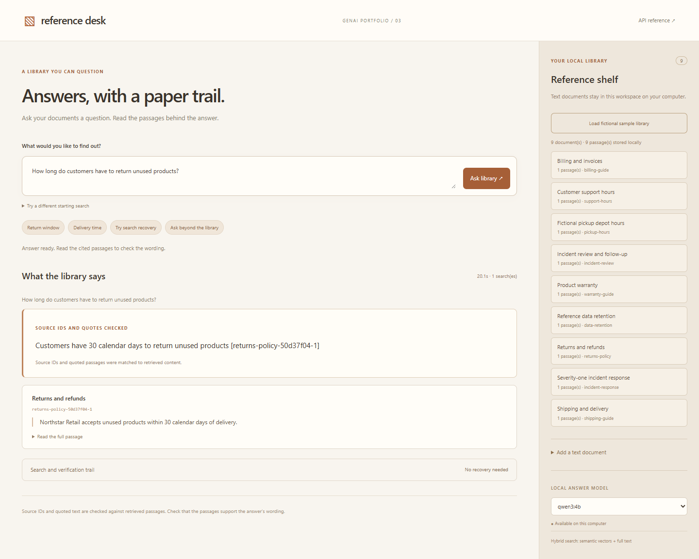
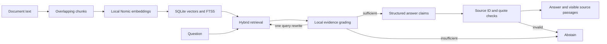

# 03 — Reference Desk: Agentic RAG

A local reference library that retrieves documents, grades whether the evidence can answer a question, tries at most one rewritten search, and returns answers with checked source IDs and source passages. The application uses real Ollama embeddings, SQLite persistence and LangChain structured local-model calls.

## Run

From the portfolio root:

```powershell
.\scripts\Setup.ps1
.\scripts\Start-Ollama.ps1
# Another terminal, targeting the portfolio model store:
$env:OLLAMA_HOST = '127.0.0.1:11435'
ollama pull nomic-embed-text:v1.5
ollama pull qwen3:4b
.\scripts\Start-Rag.ps1
```

Open <http://127.0.0.1:8103>, then choose **Load fictional sample library**. Ask about the return window or standard delivery. You can also paste a plain-text/Markdown document, supply a unique ID, and ask about its contents. Existing document IDs are preserved; revised documents need new IDs.

The standard library is under `.runtime/rag/library.sqlite3`. `RAG_INDEX_PATH` may select another index inside this checkout's `.runtime` directory; paths outside it are rejected. Verification uses `.runtime/rag-qa/library.sqlite3` to keep fictional sample evidence separate from user documents. No library database or model weights are committed.



## Architecture



- Nomic v1.5 receives `search_document:` and `search_query:` task prefixes. Provider vectors must be finite, nonzero, dimension-consistent and normalized before indexing. Inputs use `truncate=false`; overlong model inputs fail instead of silently dropping text.
- Chunks have a versioned source ID derived from document ID, content hash and ordinal. Full source text, chunks, model tag, vector dimension and vectors persist in SQLite. Ingestion validates and embeds first, then commits document/vector/full-text writes together. Repeated identical ingestion avoids new embeddings; conflicting IDs cannot overwrite a source.
- Search fuses cosine-vector and FTS5 ranks. FTS expressions are built from bounded literal tokens and passed as SQL values, not executed as application code or unrestricted SQL. The small index uses a bounded in-process vector scan rather than an external vector database.
- LangChain `ChatPromptTemplate` and `ChatOllama.with_structured_output` perform actual retrieval sufficiency grading and answer generation. Qwen3 runs with thinking disabled and CPU mode as the verified machine configuration. External tracing is explicitly disabled.
- Each answer permits at most two retrievals, two grading calls and one answer call, with a 240-second overall API budget. A repeated/empty rewrite stops early. Insufficient passages, unknown source IDs, unsupported quote text and model-inserted citation brackets cannot produce an accepted answer.
- Citations must refer to selected, actually retrieved chunks. Quoted text must occur in that chunk after whitespace normalization. These checks establish attribution and quote presence; they do **not** prove the claim semantically follows from the quote. The UI exposes the passages for review.
- If a paraphrase introduces a numeric/time literal absent from its verified quote, that claim is replaced with the exact source passage and labeled as a quote fallback. This is a conservative literal check, not semantic or mathematical equivalence checking.
- Model prompts use short `S1`/`S2` source aliases. The application resolves them to versioned chunk IDs and validates the resulting references; the model does not need to transcribe long content hashes. The grader receives the original question and passages, excluding the possibly misleading starting search query.

The reported `usage` and `model_call_count` cover the grading/answer model only. Embedding work is separate; successful retrieval attempts each embed one search query.

## Recovery and abstention

The optional **starting search** field makes retrieval behavior inspectable. For example, ask about unused-product returns while starting with `severity-one paging incident timeline`. The assistant must reject irrelevant incident passages, rewrite the search from the actual question, and then find return evidence. This is a deliberately weak initial query, not a claim that every ordinary query needs recovery.

Questions outside the library should abstain rather than answer from model memory. Source text is treated as untrusted reference data, including any instructions embedded in it. The model can only participate in retrieval/grading/answer generation; it has no file, shell, write, browser or external account tools.

## Verify

```powershell
.\scripts\Test.ps1
# Start a separate fictional-only QA index before producing publishable captures:
$env:RAG_INDEX_PATH = 'D:\genai-portfolio\.runtime\rag-qa\library.sqlite3'
.\scripts\Start-Rag.ps1
# Another terminal:
.\.venv\Scripts\python.exe .\scripts\probe-rag.py --model qwen3:4b
node .\scripts\check-rag-ui.cjs
.\.venv\Scripts\python.exe .\scripts\evaluate-rag.py --eval-lab-root D:\agent-eval-lab
```

Offline tests use deterministic embedding/model fixtures and real temporary SQLite databases. They verify persistence, no partial writes on failed embedding, incompatible model/dimension rejection, bounded search recovery, citation failure cases and API boundaries; they do not establish real model quality. Live evidence and its actual status are recorded separately under `docs/rag-*` and in PROGRESS.md.

The live probe permits only the known fictional sample/source IDs before writing a capture. It verifies normal source-backed questions, abstention, recovery from a deliberately irrelevant initial query, and a newly ingested fictional document. User libraries must not be used for published demo artifacts.

The evaluation script reuses Agent Eval Lab's existing runner, contracts, tool events and reports. It replays actual captured requests/results without fresh model calls, keeps evaluation labels outside the application, and labels replay latency separately from model latency. Its source/outcome checks do not establish semantic entailment.

On **6 November 2026**, the five live scenarios passed with Qwen3 4B and Nomic v1.5: returns, delivery, an unsupported discount, recovery from incident-only initial results, and a newly added pickup-hours document. The nine-document/nine-chunk, 768-dimensional index was also read from a separate process, and asking questions did not change the library. Repeated sample ingestion added no duplicate sources. The existing Agent Eval Lab passed **5/5 captured-outcome contracts** with no new model calls. The portfolio regression suite passed **113 tests**, including 36 RAG tests.

The initial grading/source-ID failures are retained in `docs/rag-initial-evaluation.json`. A later manually noticed time-format error (`14:0:00` instead of `14:00`) is preserved in `docs/rag-numeric-format-failure.json`; the final live capture demonstrates the verified-source quote fallback correcting the displayed response. These iterations illustrate why a passing outcome contract alone does not establish semantic faithfulness.

Final CPU HTTP observations were approximately **19 seconds** for returns, **27 seconds** for delivery, **12 seconds** for abstention, **42 seconds** for the recovery case and **32 seconds** for the newly ingested source. They are individual local measurements, not performance guarantees.

## Bounds and limitations

The MVP accepts up to 40 documents / 300 chunks, 12,000 characters per source, approximately 1,000-character chunks and two retrieved chunks per attempt. It supports pasted text/Markdown, not file parsing, web crawling or PDF ingestion. There is no source editing/deletion UI, authenticated sharing or hosted service. The model tag and vector dimension are checked; replacing weights behind the same model tag requires a fresh index.

Adding a revised source under a new ID does not retire the old one. Conflicting versions require manual library curation; the MVP does not resolve their authority automatically.

Retrieval and grading can miss relevant evidence or abstain unnecessarily. Matching a quote does not independently validate a paraphrase's meaning. CPU inference can take minutes on a cold model; inspect recorded timings rather than assuming hosted-model speed. The authored demo library and smoke cases are not a broad RAG benchmark. An external vector store, more retrieval diversity and calibrated entailment evaluation are future upgrades, not features claimed here.

Primary references: [Ollama embeddings](https://docs.ollama.com/api/embed), [Nomic task prefixes](https://huggingface.co/nomic-ai/nomic-embed-text-v1.5), [SQLite FTS5](https://www.sqlite.org/fts5.html).
