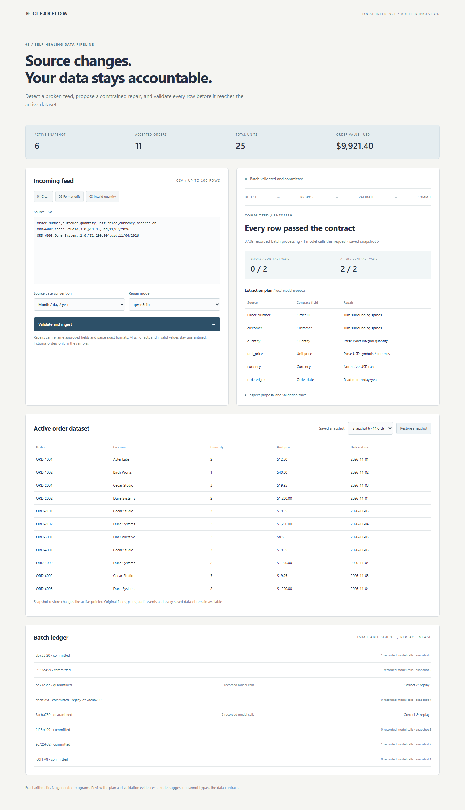
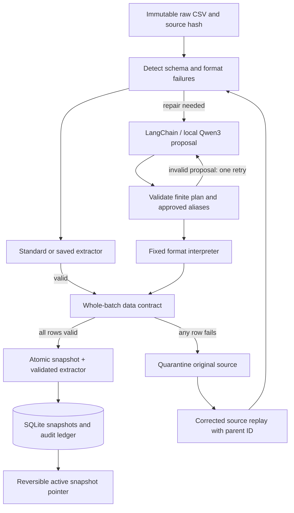

# 05 — Clearflow: Self-healing data pipeline

A local order feed detects schema/format drift, asks a real local model for a repair, interprets a **finite extraction configuration**, validates every row, and atomically publishes a new SQLite snapshot. Failed batches stay quarantined with the original source, rejected plans and errors. Corrected-source replay retains parent lineage; snapshot restoration preserves all history.

## Run

From `D:\genai-portfolio`:

```powershell
.\scripts\Setup.ps1
.\scripts\Start-Ollama.ps1
# Another terminal, targeting the dedicated D: model store:
$env:OLLAMA_HOST = '127.0.0.1:11435'
ollama pull qwen3:4b
.\scripts\Start-Pipeline.ps1
```

Open <http://127.0.0.1:8105>. Select the samples in order:

1. **Clean:** two orders load directly, totaling **$65.00**; no model call is needed.
2. **Format drift:** renamed headers, integral decimal quantities, USD symbols/grouped commas, lowercase currency and month-first dates need repair. The two normalized orders bring the active dataset to **four orders / $2,524.85**. The validated extraction plan is saved and reused for later batches with the same header signature and date profile.
3. **Invalid quantity:** a zero quantity stays quarantined. Choose **Correct & replay**, replace `,0.0,` with `,2.0,`, then replay the corrected source. This is a human correction of a missing/invalid fact; the model never invents a quantity. The original invalid CSV remains unchanged.

Choose a saved snapshot and **Restore snapshot** to change the active dataset pointer. Restoring another revision can undo that selection. Snapshot restoration is reversible; it does not erase sources, reports, audit events, saved snapshots or validated extractor configurations.

Default state is `.runtime/pipeline/audit.sqlite3`. `PIPELINE_STATE_PATH` may select another file inside this checkout's `.runtime` directory. QA uses separate databases under `.runtime/pipeline-qa`; no database, browser profile or model weights are committed. All provided CSVs are fictional. The API and Ollama bind to loopback.



## Architecture



The local model sees bounded error logs, approved aliases, allowed operations, the declared date convention and at most three sample rows. LangChain structured output produces JSON rules with `source`, `target` and `transform`. The pipeline validates the entire proposal before interpreting it. It updates an extraction specification rather than generating or executing a replacement Python script.

| Contract field | Validation / allowed normalization |
| --- | --- |
| Order ID | `ORD-` plus four digits; trim only; unique in a batch and the active dataset |
| Customer | Nonempty printable name, at most eighty characters; trim only |
| Quantity | Exact positive whole number, at most ten thousand; decimal quantities must have a zero fractional part |
| Unit price | Positive USD value up to $100,000; exact cents; optional dollar symbol and correctly grouped commas |
| Currency | USD only; case normalization allowed; no currency conversion |
| Ordered on | Real 2020–2035 date; explicit ISO, year-first slash or declared month-first slash format |

Approved source aliases are in `contract.py` and exposed by `/api/config`. Unknown headers require a reviewed contract update. Every source column and every target must be mapped exactly once; dropping fields, rounding money, deleting rows, inventing defaults, swapping unapproved meanings, running expressions or converting currencies is forbidden. Ambiguous dates follow the source convention chosen by the user; the model cannot silently select a different convention.

Validation is **all or nothing per batch**. Even if one row is valid and another fails, neither is promoted. Commit also refuses existing order IDs, capacity overflow and a changed active revision. This prevents a repair prepared before a concurrent snapshot restoration from publishing against stale data. Every snapshot is immutable; rollback changes a pointer inside a transaction.

Validated extractors are keyed by policy version, exact header sequence and date convention. Cached reuse keeps the ID of the batch that originally learned the plan, rather than relabeling each reuse as a new learned version. A new model-proposed plan only replaces the registered extractor after every row passes and the snapshot commits. Data rollback keeps this validated registry; a later incompatible source must validate or request another repair.

## Bounds and failures

Requests allow at most **32,000 UTF-8 CSV bytes**, **200 rows**, **two model proposals** and **180 seconds**. There is one active ingestion per API process, with optimistic checks for independent rollback requests. This MVP caps saved batches at five hundred and the active dataset at one thousand orders. The browser previews the first fifty orders. Prices and totals use integer cents; no floating-point rounding is used for stored values.

Malformed CSV, unapproved columns, invalid proposals, non-integral quantities, impossible dates, foreign currency, duplicate IDs, unavailable local models and exhausted attempts cannot promote a batch. They leave a saved quarantined result when the input passed the HTTP envelope checks. A crash or storage failure may leave a `processing` record with its raw source; it is not reported as committed. There is no background retry or destructive cleanup.

Byte-identical input, date profile and replay parent return the existing immutable batch outcome. An idempotent response retains the original processing duration and trace, while `model_calls_this_request=0`; current active state is returned separately. To reconsider a quarantined source, use explicit replay. A corrected replay creates a new source hash and batch ID, linked to the original. The UI labels reported batch processing time accordingly.

The finite language is enforced by repository-owned parsers and validators; no model-generated Python, SQL, shell, regex or import is executed. This scope does not require an arbitrary-code sandbox. It is a small CSV/order-contract MVP, without streaming brokers, unrestricted transformations, arbitrary schema discovery, production access control or proof of semantic correctness for new aliases. User-supplied source data stays local; publish only fictional QA captures.

## Verification

```powershell
.\scripts\Test.ps1
# In a separate API terminal BEFORE starting the API:
$env:PIPELINE_STATE_PATH='D:\genai-portfolio\.runtime\pipeline-qa\fresh-run.sqlite3'
.\scripts\Start-Pipeline.ps1
# Another terminal, with Ollama running:
.\.venv\Scripts\python.exe scripts/probe-pipeline.py --state-path D:\genai-portfolio\.runtime\pipeline-qa\fresh-run.sqlite3
npm ci --cache .cache/npm
npm run test:pipeline-ui
.\.venv\Scripts\python.exe scripts/evaluate-pipeline.py --eval-lab-root D:\agent-eval-lab
```

The live probe requires a **fresh dedicated QA database** so it cannot label a cached or idempotent result as fresh model inference. Preserve earlier attempts under a different filename rather than clearing user data. The browser probe uses another approved header combination to exercise a new real model repair, then inspects the trace, quarantine replay editor, saved snapshots and mobile layout. For another browser attempt on the same QA store, use an unused variant, for example `node scripts/check-pipeline-ui.cjs 2`; repeated variants correctly fail the fresh-inference assertion. The API probe checks standard ingestion, real repair, idempotence, learned-plan reuse, invalid-value quarantine, corrected-source replay, unknown-schema quarantine, stale rollback refusal and restoration. A separate SQLite connection confirms persistence and the original quarantined source hash.

Evidence is in [the actual capture](../../docs/pipeline-live.json), [browser results](../../docs/pipeline-browser.json), desktop/mobile screenshots and [existing Eval Lab replay](../../docs/pipeline-eval/report.html). Replay uses the existing Agent Eval Lab without modifying it, makes no new model calls and reports replay overhead. Its `ToolEvent` records represent pipeline stages, not MCP tools or remote services. Authored checks do not constitute a production data-quality benchmark.

Final results: **174 portfolio tests passed**, including **37 pipeline tests**; **7/7 live API cases** and **3/3 captured-stage replay contracts** passed. The actual CPU model repair used one call and took **31.347s HTTP time**. The invalid zero-quantity case tried two plans and was quarantined after **67.613s**; cached extraction and corrected replay used no model calls. The separate browser repair used one actual call in **37.022s** with no JavaScript errors or 390px horizontal overflow, and verified the replay editor plus snapshot restoration. The browser screenshots contain additional accepted QA batches beyond the seven-order API capture. These are individual laptop observations, not performance guarantees.
