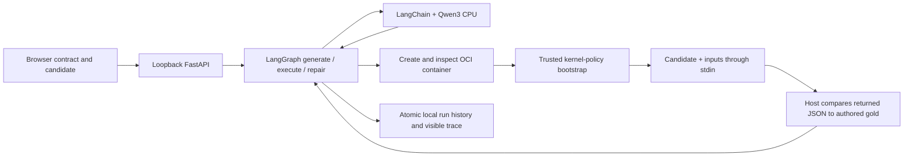

# Repair Bench — self-correcting code assistant

A local Qwen3 model generates or repairs `solve(data)`, an actual LangGraph workflow runs it in a fresh inspected Linux container, and the next proposal receives the real failure. The browser shows every candidate, test result, model call and isolation observation. Two small authored contracts cover an empty-safe mean and sorted unique ASCII words.

## Run on this Windows machine

Prerequisites: Python/project environment from `scripts/Setup.ps1`, Ollama, and an existing WSL installation with native container support. Verified here with WSL **3.0.3.0**, kernel **6.18.54.1-1**, and its installed `C:\Program Files\WSL\wslc.exe`. Setup checks prerequisites and fails closed; it does not enable Windows components, modify `.wslconfig`, install Docker Desktop or register a startup service.

```powershell
cd D:\genai-portfolio
.\scripts\Setup.ps1
.\scripts\Start-Ollama.ps1
# In another terminal:
$env:OLLAMA_HOST='127.0.0.1:11435'
ollama pull qwen3:4b
.\scripts\Setup-CodeAssistant.ps1
.\scripts\Start-CodeAssistant.ps1
```

Open <http://127.0.0.1:8106>. Load the failing mean sample and run the repair loop, or choose the word contract and generate from scratch. Startup is one command after setup. `CODE_PORT`, `CODE_RUNS_PATH` and `OLLAMA_BASE_URL` can override the project defaults. Services bind to loopback; requests must use a local Host and same origin. No hosted service or paid API is used.

Setup downloads the official **Microsoft.WSL.Containers 3.0.3** SDK into `.tools`, verifies its pinned SHA-256, creates the named `genai-portfolio-code` session through its public C API, prepares the official Python image, and executes nine hand-authored isolation controls. Session data and the actual `storage.vhdx` are under `D:\genai-portfolio\.tools\wslc-code`; model weights, caches, logs, temporary files, run records and browser profiles stay under this checkout on D:. The session helper is a hidden project process holding an API handle, not a startup service. Its session has two CPUs, 768 MB memory, a 2 GB storage limit and no GPU feature flags.

The verified image contains **Python 3.13.18** (`python:3.13-alpine`). Each execution uses the recorded immutable image ID, `--pull never`, and no host mounts:

```text
sha256:67fd5f7b4b120eaa3308775fe87aff98a2492287576bd6656ef785d54a1b5605
Repo digest: python@sha256:1e1f6334529d1fb26a2ef619d7cffb30a7c7d7cc1cc7338ebee283a58d1aeaca
```

The tag is resolved during initial image preparation. Review and rerun isolation controls after an image/runtime update. An isolation proof is tied to the pinned image, trusted bootstrap hash and current session creator PID; a stale proof blocks even model generation. Stop only this project's session when finished:

```powershell
& 'C:\Program Files\WSL\wslc.exe' --session genai-portfolio-code system session terminate
```

The next start recreates the session and reruns controls. Existing WSL distributions and the independent Agent Eval Lab are left unchanged.

## Data flow and boundaries



There are at most **three candidate executions, three model calls and 240 seconds** per workflow. A starting candidate executes first; a blank candidate goes through generation. Syntax is parsed on Windows, but candidate source is never executed there. Execution errors and wrong outputs feed the repair node. Resource termination stops the graph without asking for another proposal. Model/runtime errors remain visible. Atomic JSON history is limited to 500 saved runs; the UI lists the last 20. This small file store is intended for one local service process.

Before starting a container, the runner inspects its actual immutable image, unprivileged user, network mode, mounts, resource settings, health check and project label. A trusted in-container bootstrap verifies kernel state before reading the candidate input. The child receives source and test inputs only; expected results stay in the host comparator. Returned JSON is compared with type-aware equality, so `true` cannot satisfy a numeric answer. This is a small authored algorithm suite, not proof against hard-coded answers or general correctness.

| Boundary | Actual enforcement |
| --- | --- |
| Host files | No volume/bind mounts, no Docker socket, no `/mnt/c` or `/mnt/d`; fictional host canary unchanged |
| Network | OCI network mode `none`; only loopback interface; real external connect refused |
| Privilege | UID/GID 65534, effective capabilities zero, `no_new_privileges` set before candidate source is loaded |
| Memory | 128 MB cgroup memory plus hard **128 MB address-space limit**; actual 256 MB allocation refused |
| Processes | Hard `RLIMIT_NPROC=1` before candidate execution; actual subprocess creation refused |
| CPU/time | Hard two CPU seconds; 0.5 CPU allocation; six-second host wall deadline with explicit kill/removal |
| Files | Hard `RLIMIT_FSIZE=0`; nonempty regular-file writes refused. Empty-file/metadata changes inside the disposable container are not a read-only root filesystem |
| Output | 4 KiB stdout + 4 KiB stderr retained; overflow kills execution; discarded bytes continue draining to avoid attach backpressure |
| Cleanup | Exact run container removed in `finally`; control failure stops only the owned session and invalidates its proof |

The container initializer needs a 2 GB address-space limit and process limit 16 to start `runc`; the trusted, unprivileged bootstrap irreversibly lowers both hard limits to 128 MB and one process before reading any candidate source. The engine reports that swap-limit support is unavailable on this WSL kernel. The hard process address-space and process-count limits are therefore part of the memory boundary; no swap-cgroup guarantee is claimed. The CPU and wall limits constrain candidate execution, while container setup/inspection/cleanup add separate overhead.

## Verification and evidence

- `scripts/Test.ps1`: **195 passed in 86.44 seconds**, including **21 code workflow/policy/API tests**. These tests use explicitly labeled fixture model/sandbox results to check actual graph routing, attempt budgets, bad syntax, resource stops, isolation refusal, strict comparisons, persistence and HTTP boundaries; they do not execute generated code on the host.
- `scripts/probe-code-isolation.py`: **9/9 actual native-container controls passed** before any model-generated candidate executed: function result, host-file absence, regular-file write refusal, network refusal, process refusal, memory refusal, CPU termination, wall termination and output termination. [Final capture](../../docs/code-isolation.json); [initial control capture](../../docs/code-isolation-initial.json).
- `scripts/probe-code-core.py`: two real Qwen3/graph/container workflows passed. Mean repair: one call/two executions, **25.4s**; word generation: one call/one execution, **15.6s**. [Core capture](../../docs/code-core-live.json).
- `scripts/probe-code-assistant.py`: **3/3 HTTP workflows passed**, including persisted-record equality. Mean repair corrected an actual `ZeroDivisionError` in one model call/two executions (**30.9s HTTP**). Word generation passed all four examples in one call/one execution (**20.4s HTTP**). A 30-second sleep was stopped at the six-second execution wall deadline, with **zero model calls/retries** (**8.3s HTTP**). [Capture](../../docs/code-assistant-live.json).
- `npm run test:code-ui`: actual Edge → API → Qwen3 → isolated failing sample/repair in **17.6s** (one call/two executions), trace inspection, history after reload, desktop/mobile layout without horizontal overflow, embedding-model exclusion and zero JavaScript errors. [Browser evidence](../../docs/code-browser.json), [desktop](../../docs/code-desktop.png), [mobile](../../docs/code-mobile.png).
- `python scripts/evaluate-code.py --eval-lab-root D:\agent-eval-lab`: existing Lab contracts/runner/reporting replay the three recorded outcomes and graph paths. [Report](../../docs/code-eval/report.html). This makes no fresh model calls or candidate executions; its timing is replay overhead and its policy fields are captured observations.

All live inference used `qwen3:4b` on CPU (`LOCAL_AI_NUM_GPU=0`) on this i5-9300H/24 GB Windows laptop. The nine isolation controls are hand-authored operational checks, separate from model quality. The initial output-flood check exposed a blocked attach stream; continuing to drain discarded bytes fixed it. The owned session was stopped/restarted, and all nine controls passed before generation was enabled. An earlier Windows AppContainer prototype failed before executing a test and was abandoned; it is not a supported fallback.

The MVP supports Python standard-library pure functions and two fixed contracts. It does not install candidate packages, repair repositories, support arbitrary test uploads, or promise kernel/VM escape resistance against unknown runtime vulnerabilities. Container isolation, hard resource limits and authored cases are the implemented boundaries. Missing WSL/native container support is a visible blocker rather than a host-execution fallback.

## Primary references

- [LangGraph workflows and agents](https://docs.langchain.com/oss/python/langgraph/workflows-agents)
- [Microsoft native WSL containers](https://learn.microsoft.com/en-us/windows/wsl/wsl-container)
- [WSL container settings](https://learn.microsoft.com/en-us/windows/wsl/wsl-container-settings)
- [WSL public API reference](https://wsl.dev/api-reference/) and the pinned SDK header shipped by Microsoft
- [Docker Engine resource constraints](https://docs.docker.com/engine/containers/resource_constraints/)
