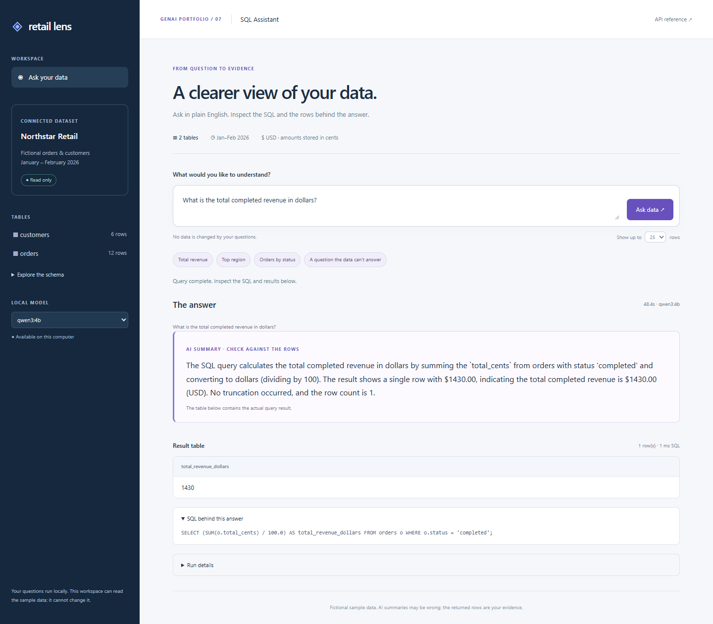
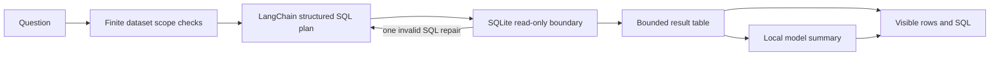

# 07 — Retail Lens: SQL Assistant with LangChain

Ask a local model a question about a fictional retail database, then inspect the SQL, actual rows and a short explanation. The sample has six customers and twelve orders from January–February 2026. It contains no user or customer data.

## Run

From the portfolio root:

```powershell
.\scripts\Setup.ps1
.\scripts\Start-Ollama.ps1
# Another terminal, using the portfolio's D: model store:
$env:OLLAMA_HOST = '127.0.0.1:11435'
ollama pull qwen3:4b
.\scripts\Start-SqlAssistant.ps1
```

Open <http://127.0.0.1:8107>. API documentation: `/docs`. Select an installed model. CPU inference is the default verified hardware path; `LOCAL_AI_NUM_GPU` is the same override used by Local AI Studio. The UI prefers `SQL_DEFAULT_MODEL` when installed, otherwise an available model. The live evidence records the model actually tested.

The verified SQL model is **Qwen3 4B Q4_K_M**, with thinking disabled for bounded structured responses. Its approximately 2.5 GB of weights live under `.models` on D:, outside Git.

Example questions: “What is the total completed revenue in dollars?”, “How many orders are there for each status?”, or “Which region has the highest completed revenue in dollars?”



Revenue is defined as completed order amounts; refunded/cancelled orders are excluded. Amounts are stored as integer cents, and SQL divides by `100.0` for USD. Costs and profit do not exist in the sample.

## How it works



The planner receives the schema and business definitions, not sample rows or evaluation labels. `ChatPromptTemplate` and `ChatOllama.with_structured_output` provide the actual LangChain model path. Only executed query results are sent to the summarizer. External LangSmith tracing is explicitly disabled.

A missing-column/syntax error permits one repair. Forbidden operations and exhausted query budgets stop immediately. A failed summary preserves the result table and returns an explicitly labeled row-count fallback. Model token totals remain unknown if any call's usage is unknown. The app serves one generated answer at a time, with a 150-second overall request budget.

## Database boundary

The generated SQL is not trusted. Every execution opens a new SQLite URI connection with `mode=ro`, enables `query_only`, disables trusted schema/extensions and installs a default-deny SQLite authorizer. Reads are limited to the two approved tables/columns and an allowlist of ordinary analysis functions. Writes, schema changes, transactions, ATTACH, PRAGMA, recursive CTEs and extension functions are rejected by the database boundary. `execute`, rather than `executescript`, enforces one statement. Source-controlled setup SQL is separate from model output.

Queries have a 100,000 VM-instruction budget, a 0.5-second progress-handler deadline, compiler/expression limits and result caps. Results expose at most 50 rows, 16 columns, 1,000 characters per text cell and 12,000 serialized row characters. Truncation is visible. This is a bounded SQLite query interface, not an OS sandbox or a hard process-memory limit.

## Verify

```powershell
.\scripts\Test.ps1
.\.venv\Scripts\python.exe .\scripts\probe-sql.py --model qwen3:4b
node .\scripts\check-sql-ui.cjs
.\.venv\Scripts\python.exe .\scripts\evaluate-sql.py --eval-lab-root D:\agent-eval-lab
```

- Offline tests use scripted model fixtures and real temporary SQLite databases. They do not measure model quality.
- The live probe makes real model calls for supported questions, exercises deterministic scope routing and directly verifies refused database operations. The capture records which cases actually called the model.
- `evaluate-sql.py` reuses the existing Agent Eval Lab, without modifying it. It replays captured outcomes/tool events against separate authored contracts; it makes **no fresh model calls**. Report latency is replay overhead. It checks structured results and actual SQL tool paths, not semantic faithfulness of the prose summary.
- `docs/sql-assistant-live.json` and `docs/sql-assistant-browser.json` contain actual verification. The initial failed evaluation is retained separately so the limitations and changes are inspectable.

On **6 November 2026**, all six authored scenarios passed: four used actual Qwen3 SQL planning and summarization, and two used the explicit dataset policy without model calls. All four direct database guard probes were refused, and the database fingerprint stayed unchanged. The portfolio suite passed **77 tests** (50 for SQL), and the existing Agent Eval Lab passed **6/6 recorded-outcome contracts**, with no fresh inference during replay. Desktop/mobile browser checks passed with no JavaScript errors or mobile horizontal overflow; refusal and clarification were also checked in the UI.

Observed CPU request times were about **120 seconds cold** and **25–32 seconds** for subsequent live HTTP samples. A separate browser request took about 48 seconds. These individual observations are not a latency guarantee.

## Limits and upgrade path

The initial Qwen2.5 1.5B run omitted a join and invented a profit calculation; a later run also omitted a cents-to-dollars conversion. Both failure captures are preserved. Schema instructions were strengthened, finite English scope checks were added, and Qwen3 4B passed the recorded cases. This changed both the model and application guidance, so it is not a controlled model-only comparison. The scope checks are conservative vocabulary rules, not universal intent detection. Unrecognized paraphrases still depend on model judgment, while the database guard independently prevents writes.

Summaries can still be wrong even when SQL runs successfully. The visible SQL and returned rows are the evidence. Six authored smoke cases are not a broad benchmark or a guarantee on arbitrary questions. The sample database is fixed and fictional; there is no upload or production datasource path.

A PostgreSQL version should use a dedicated restricted role, a read-only transaction, statement/row limits and a schema allowlist; retain model-independent permissions and result visibility. That backend is a documented upgrade, not an implemented feature here.

Primary references: [LangChain ChatOllama](https://docs.langchain.com/oss/python/integrations/chat/ollama), [Python sqlite3](https://docs.python.org/3.13/library/sqlite3.html), [SQLite authorization callbacks](https://www.sqlite.org/c3ref/set_authorizer.html).
