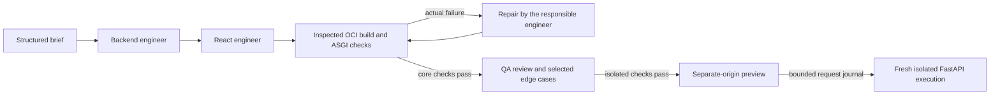

# Assembly · Full-stack app builder

Assembly takes a short brief and produces a small item tracker. Three local model calls can write the FastAPI backend, generate the React interface and review the actual build and API results. A separate preview lets you add an item, mark it done and delete it. The build history records the generated sources, test outcomes and isolation checks.

## Start locally

Use PowerShell 7 and a Windows checkout on D: with the portfolio Python environment, Ollama and Microsoft WSL native containers. Setup builds a trusted toolchain in the project-owned container session. It uses the pinned Python 3.13 image, FastAPI 0.162.0, HTTPX 0.28.1, React 19.3.1 and esbuild 0.28.2.

```powershell
cd D:\genai-portfolio
.\scripts\Setup.ps1
.\scripts\Setup-AppBuilder.ps1
.\scripts\Start-Ollama.ps1
```

In another terminal, pull the model into the portfolio Ollama instance if needed, then start the builder.

```powershell
$env:OLLAMA_HOST='127.0.0.1:11435'
ollama pull qwen2.5-coder:1.5b
.\scripts\Start-AppBuilder.ps1
```

Open <http://127.0.0.1:8108>, keep the fictional **Reading Room** brief and select **Build this application**. The CPU build can take several minutes. Open the trace to inspect the three role outputs and test results. In the preview, add `The Cedar Atlas`, check it off and reload the saved build. The preview starts a fresh journal when you use **Reset preview**.

## Build and preview



- The brief controls title, item label and presentation within a fixed create/list/update/delete contract. The backend role writes four Python functions called by a trusted FastAPI scaffold that supplies request validation, async signatures and status codes. The frontend role writes `App.jsx` against a trusted React request and state helper. The builder saves the two allowed source files to a run directory and records content hashes.
- The trusted image build accepts its dependency locks and runner. Generated source enters a disposable container over stdin after OCI inspection. The runner builds JSX with esbuild and invokes generated FastAPI routes with HTTPX ASGI transport. Host checks compare status and JSON against independently authored expectations. The QA model chooses extra checks from a finite catalogue. A failing check can trigger one repair with concrete feedback.
- The inspected container has no host mounts or network, UID 65534, a 384 MiB memory limit, half a CPU and an eight CPU-second limit. Before loading generated Python the runner further lowers address space to 256 MiB, allows one process and forbids regular-file data writes. Each isolated execution has bounded input, output and a 30-second wall deadline.
- The preview origin on port 8118 serves the verified React bundle into a sandboxed iframe and forwards only the item routes. Each request replays its prior request journal through the generated FastAPI app in a fresh container. A changed response prefix or source hash stops preview execution. The journal holds 30 requests and can be reset. The runtime stores model output, journals, caches and container images under the project checkout on D:.
- Generation has two build attempts, up to six model calls and a 540-second workflow deadline. The proof gate ties execution to the current session and toolchain image. Model, build and QA failures remain visible in the run history.

This MVP supports small, deterministic in-memory item trackers with a bounded local preview. The QA role reviews code and chooses tests. The authored scenarios and browser check cover the demonstrated behavior.

## Verification

`scripts/Test.ps1` runs the frozen offline suite. For a repeatable live check, set `APP_BUILDER_STATE` to `D:\genai-portfolio\.runtime\app-builder-qa` before running `Start-AppBuilder.ps1`. Then run `uv run --frozen python scripts/probe-app-core.py` to request a build over HTTP and record its isolated build and API checks. Install the browser harness with `npm ci --cache .cache/npm` and run `node scripts/check-app-ui.cjs` to open the saved real build and exercise it with fresh container requests. The browser uses a dedicated Edge profile under `.runtime`.

The verified Reading Room build used `qwen2.5-coder:1.5b` on CPU. Three model calls and one build attempt passed **10/10** API checks in **65.5s** over HTTP. The saved record matched the HTTP response. Edge created, checked off and deleted fictional books and confirmed the state after reload. Six preview requests after reset took **3.0–4.9s** each inside their containers in the captured browser check. The frozen suite passed **215 tests**, including 20 app-builder tests.

Evidence. [Live build and generated source](../../docs/app-builder-core-live.json), [browser check](../../docs/app-builder-browser.json), [generated preview](../../docs/app-builder-preview.png), [desktop](../../docs/app-builder-desktop.png), [mobile](../../docs/app-builder-mobile.png), [five isolation controls](../../docs/app-isolation.json).

The early runs document why the app uses trusted scaffolds and direct code output. [Initial FastAPI failure](../../docs/app-builder-initial.json), [Qwen3 compile and repair trace](../../docs/app-builder-qwen3-failed.json), [structured source output failure](../../docs/app-builder-structured-coder-failed.json).

The local runtime and build use the documented native container, ASGI and bundling interfaces. [Native WSL containers](https://learn.microsoft.com/en-us/windows/wsl/wsl-container), [FastAPI async tests](https://fastapi.tiangolo.com/advanced/async-tests/), [React build guidance](https://react.dev/learn/creating-a-react-app), [esbuild browser bundling](https://esbuild.github.io/getting-started/#bundling-for-the-browser), [Ollama coder model](https://ollama.com/library/qwen2.5-coder:1.5b).
